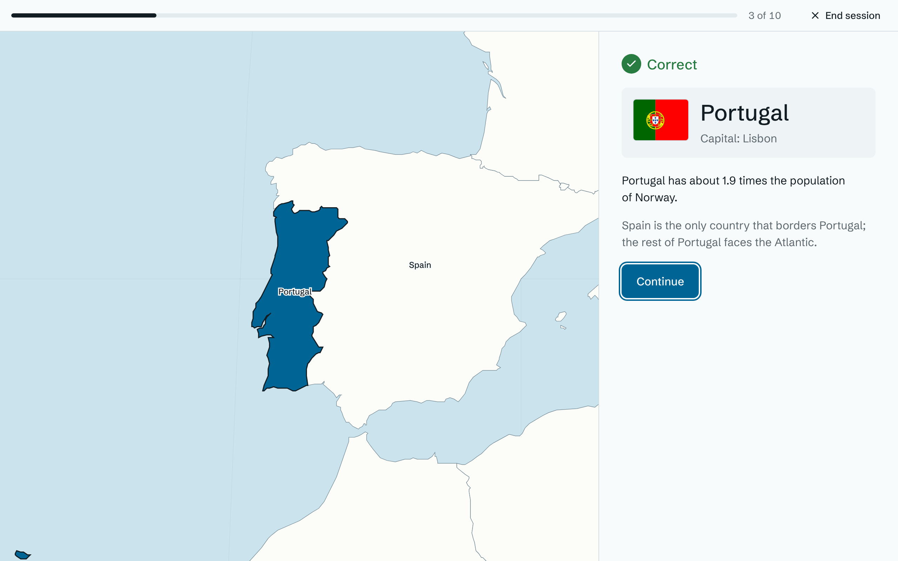
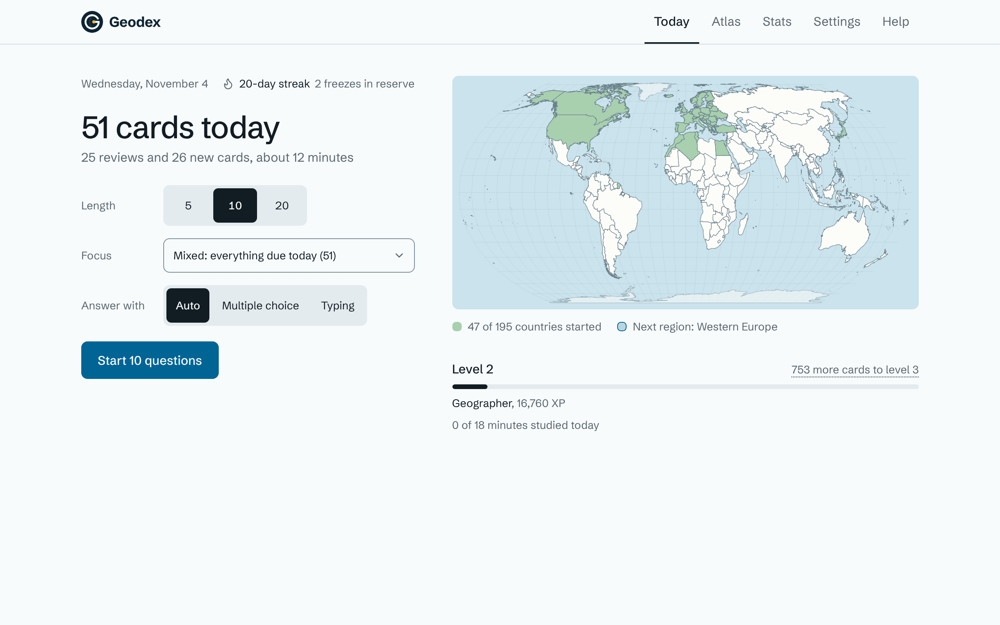
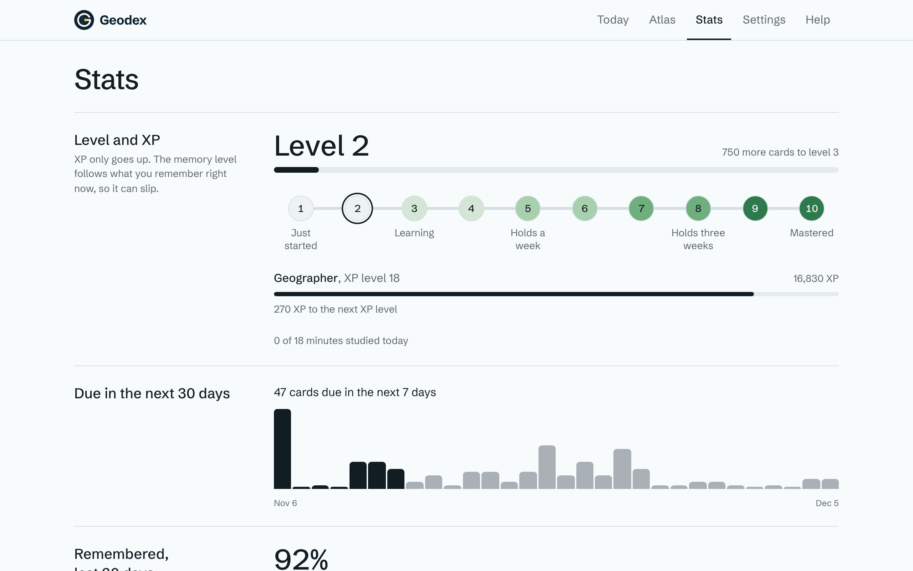
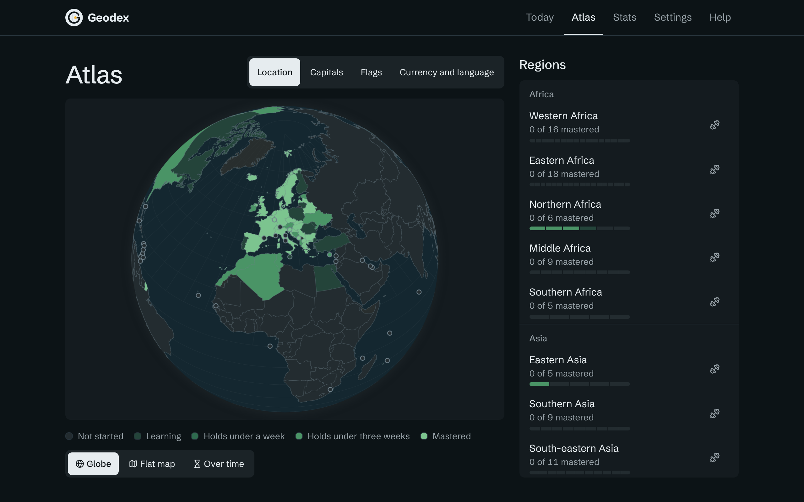
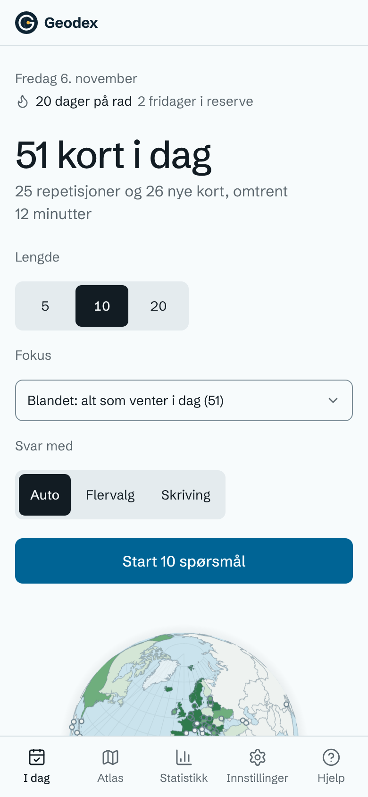
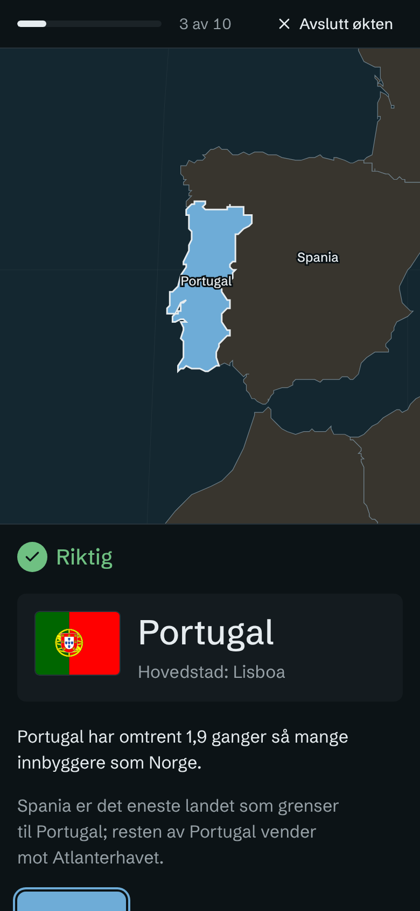

<p align="center">
  <picture>
    <source media="(prefers-color-scheme: dark)" srcset="assets/brand/svg/geodex-lockup-on-dark.svg">
    
  </picture>
</p>

# GeoDex

Learn every country, capital and flag, a few minutes a day.

GeoDex is a spaced-repetition geography trainer. Each card comes back just before you would forget it, you answer on a real map, and every answer tells you something that helps it stick. It is free, runs in the browser, works offline and needs no account: [geodex.dilovanzm.workers.dev](https://geodex.dilovanzm.workers.dev)

https://github.com/user-attachments/assets/22f138da-36ce-4adc-8e9b-b36fe594b7f5

<sub>The music in the demo is an original track made for GeoDex and is in the public domain (CC0); see [`docs/media/CREDITS.md`](docs/media/CREDITS.md).</sub>

## What it does

- **All 197 countries.** Where they are, their names, capitals, flags, currencies and official languages, including Kosovo, Palestine, Taiwan and the Vatican.
- **Five more topics to turn on.** 38 famous cities, 39 groups of countries (the Nordic countries, the Balkans, the EU), 120 landmarks with photos, 91 rivers, seas, lakes, ranges and deserts, and a history layer of former names, dissolved states and empires, with borders over time on the globe.
- **Answers on a real map.** Equal Earth for close-ups, so sizes look the way they are, and a globe for the whole world. Every map answer can also be given from a list, by keyboard or with a screen reader.
- **A memory engine, not a quiz.** FSRS-6 schedules every card. You never rate yourself: the app grades from what you did, and questions get harder as a card gets stronger.
- **Answers that explain themselves.** A memory hook, a fact or a comparison with your home country after every answer, from reviewed text in both languages. Two mix-ups between the same pair (Slovakia and Slovenia, Niger and Nigeria) add a card that teaches the difference.
- **Progress you can see.** Today plans the day from the minutes you have. The Atlas colours the world by how well you know it, and Stats shows levels, ranks, streaks and what is coming up.
- **English and Norwegian, light and dark.** Each language is written separately, not translated.
- **Yours alone.** Progress stays in your browser and is never sent anywhere. A backup file moves it to another device.



| Today | Stats |
|---|---|
|  |  |
|  |  |

<p align="center">
  
  &nbsp;&nbsp;
  
</p>

## How it works

- **Scheduling.** Every card has a stability (days until recall drops to 90%) and a difficulty, updated after each review with the FSRS-6 model ([ts-fsrs](https://github.com/open-spaced-repetition/ts-fsrs)). Reviews come back when they are about to be forgotten, not on a fixed ladder.
- **Grading.** You never rate yourself. A wrong answer is Again. A right answer is Good, or Hard after a hint, a typo or a slow answer, or Easy when it is typed or tapped well under your usual time. Picking from options tests recognition only, so it never earns Easy. Time spent reading the explanation never counts.
- **Harder as you go.** A new card starts with options on a close map. As its stability grows you type the answer, and the map widens to the continent, then the world.
- **Mix-ups.** Wrong answers are counted per pair over 90 days. Two mix-ups between the same pair (Slovakia and Slovenia, Niger and Nigeria) add a contrast card that teaches the difference, and wrong options favour the pairs you confuse.
- **Explanations.** Each answer gets a memory hook (a shape, a name's origin, a sound-alike, a story), a fact or a comparison with your home country, chosen from reviewed text in both languages. Hook types that work for you are chosen more often; "Not helpful" hides one.
- **Nothing is lost.** Every answer is an append-only event; card state is a cache rebuilt from the events. Restoring a backup adds missing events and can never remove one, and "Start over" records a time instead of deleting anything.


More in [`docs/ARCHITECTURE.md`](docs/ARCHITECTURE.md). Design decisions and their reasons are in [`docs/DECISIONS.md`](docs/DECISIONS.md).

## Your progress

Progress is saved in your browser after every answer and is never sent anywhere, so clearing the browser's data erases it. Settings has a backup file to download and restore; it is also the way to move your progress to another device.

## Tests

- **Unit tests** (Vitest) cover the engine in `src/engine/`, and CI fails below 90% line coverage. Data tests check every country, city, landmark, feature and outline.
- **End-to-end tests** (Playwright) run at 1440x900 and 390x844, in light and dark and both languages, with axe checking the WCAG 2.2 AA rules on every screen.
- **Content checks.** `pnpm content:lint` holds all text to the voice rules in [`content/VOICE.md`](content/VOICE.md), and `pnpm content:facts` checks every hook, fact and contrast against the data: capitals, borders, coasts, languages, currencies, and largest or smallest claims ([report](content/FACT-CHECK.md)).

## CI

| Workflow | Does |
|---|---|
| `ci.yml` | Lint (Biome and a check for en and em dashes), typecheck, unit tests with coverage and the production build on every pull request, plus the commit message check. On `main`, the end-to-end suite on desktop and phone |
| `release.yml` | When the notes for a new version reach `main`, tags it and publishes the GitHub release. Keeps only the milestone releases (each major version and the latest) |
| `branches.yml` | After every merge, deletes the branches already merged into `main` |
| `outside-prs.yml` | Closes pull requests from outside with a pointer to the issues |

## Development

Requires Node 24 (`.nvmrc`) and pnpm 10.

```
pnpm install
git config core.hooksPath .githooks   # once: the commit message check
pnpm dev               # dev server
pnpm build             # typecheck and production build
pnpm test              # unit tests
pnpm test:e2e          # end-to-end tests
pnpm lint              # Biome and the no-dash check
pnpm content:lint      # VOICE.md rules on all content, both languages
pnpm content:facts     # check content against the data (content/FACT-CHECK.md)
pnpm content:review    # list facts waiting for review (content/REVIEW.md)
pnpm content:nb        # list new and changed Norwegian strings (NB-REVIEW.md, not committed)
```

## Data

Static data is generated by scripts and committed:

```
pnpm data:fetch            # fetch Wikidata, Commons, Språkrådet, UN M49 and World Bank into data/raw (gitignored)
pnpm data:fetch --refresh  # refetch instead of using the cache
pnpm data:build            # build data/countries.json, data/geo, public/flags and reports
pnpm data:verify           # build twice and check the output is byte-identical
```

`data/curated/` holds the decisions Wikidata cannot make (capital roles, names, currencies, official languages). Each build writes review reports: `data/name-mismatches.md`, `data/neighbor-mismatches.md`, `data/build-report.md`. Borders follow Natural Earth's de facto view.

## Hosting

`pnpm install && pnpm build`, then serve `dist/` from any static host with single-page-app fallback to `index.html`. The app makes no network requests except for its own files and, for landmarks, Wikimedia Commons photos.

The public site is a Cloudflare Worker serving the built app as static assets (free tier, no server code). `wrangler.jsonc` points it at `dist/` with single-page-app routing. In the Cloudflare dashboard, under the Worker's Settings, Build:

- Production branch: `main`
- Build command: `pnpm build`
- Deploy command: `npx wrangler deploy`
- Build variables: `NODE_VERSION=24`, `PNPM_VERSION=10.28.0`

Check the config locally with `pnpm build && pnpm exec wrangler deploy --dry-run`.

## Issues

Bug reports and wrong facts are welcome as [issues](https://github.com/DIZAMU/GeoDex/issues). Pull requests from others are not accepted; see [`CONTRIBUTING.md`](CONTRIBUTING.md). To report a vulnerability, see [`SECURITY.md`](SECURITY.md).

## About

GeoDex was my first actual project. I built it before [RootCause](https://github.com/DIZAMU/RootCause), but I held off on publishing it until it felt finished.

It was never about money. I wanted to see what I could create, and to cover something I felt I was lacking: geography. The result is something I am very satisfied with, and I still use it every day to keep my knowledge fresh.

I would love to hear what you think. If something breaks, a fact is wrong or something could be better, please [open an issue](https://github.com/DIZAMU/GeoDex/issues).

## License

[PolyForm Noncommercial 1.0.0](LICENSE). Free for personal and noncommercial use, with credit to DIZAMU. Commercial use is not permitted. This is source-available, not OSI open source. Data and font licenses are in [`THIRD_PARTY_NOTICES.md`](THIRD_PARTY_NOTICES.md).
