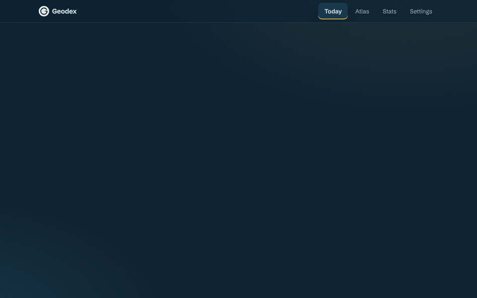
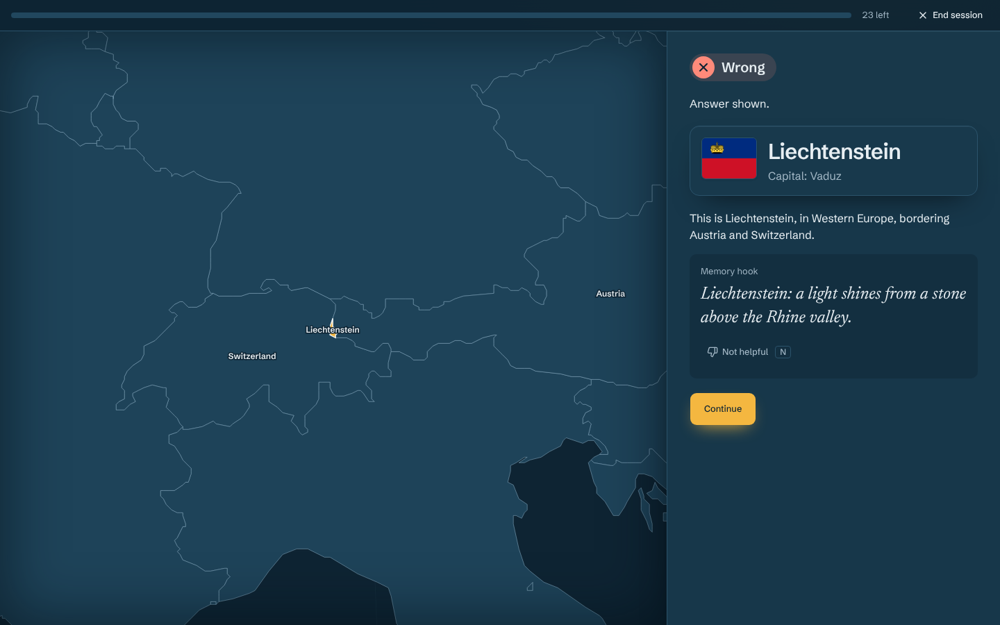
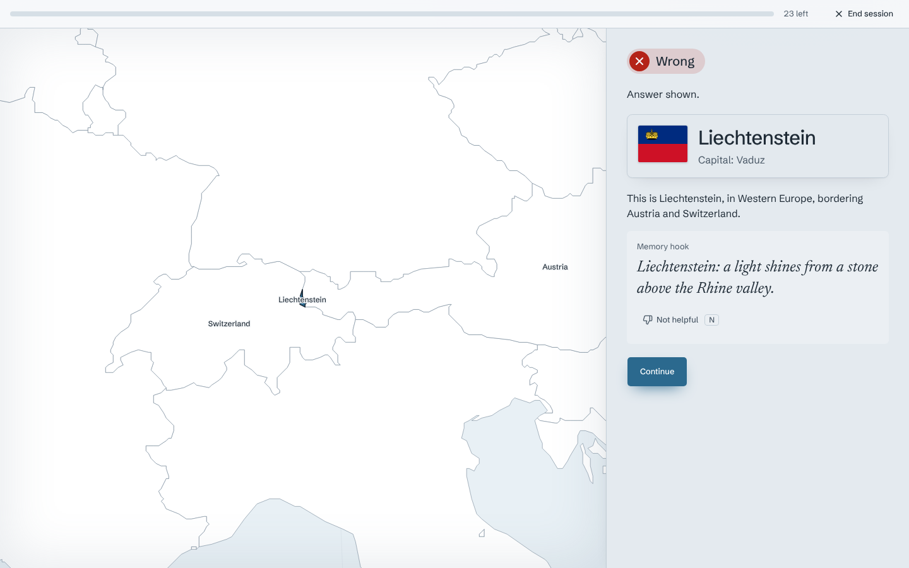
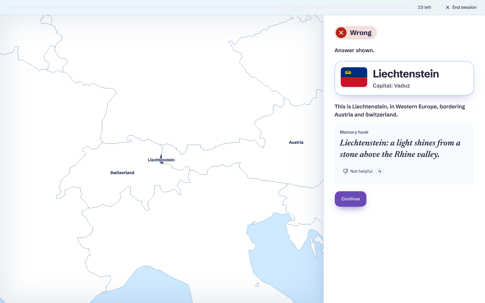
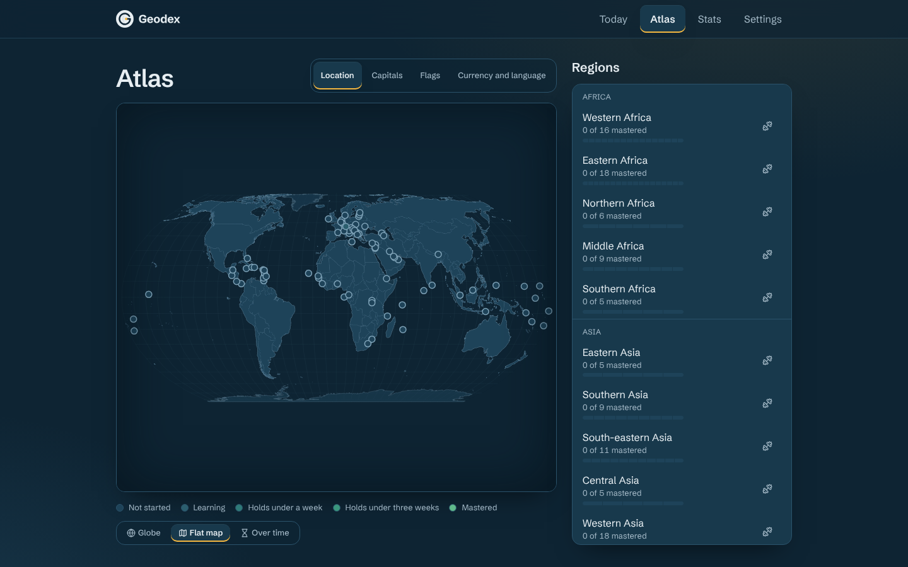
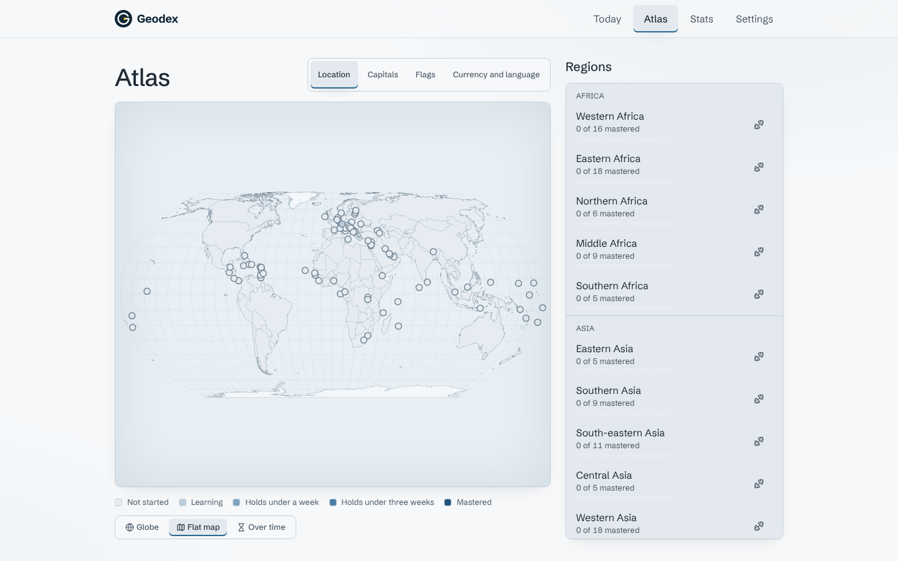
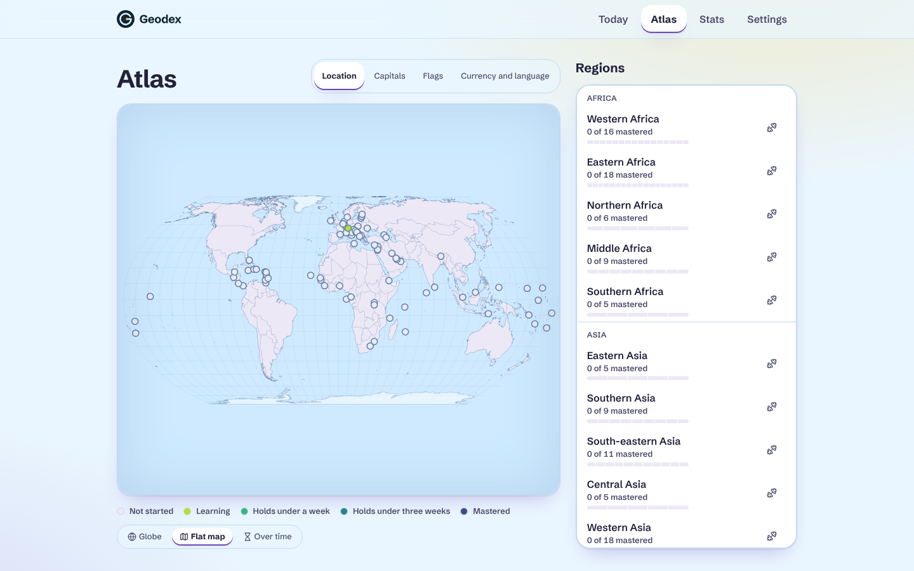
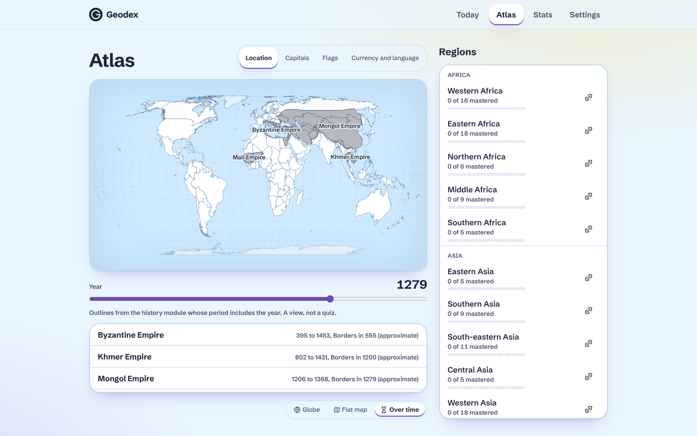
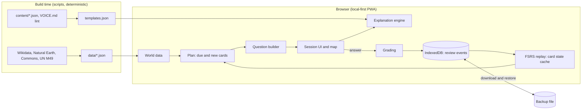

<p align="center">
  <picture>
    <source media="(prefers-color-scheme: dark)" srcset="assets/brand/svg/geodex-lockup-on-dark.svg">
    
  </picture>
</p>

# GeoDex

[](https://github.com/DIZAMU/GeoDex/actions/workflows/ci.yml)


A spaced-repetition geography trainer that learns what you confuse and explains why. Local-first PWA in English and Norwegian.

<p align="center">
  
</p>

## Features

- **197 countries** (location, name, capital, flag, currency, official languages), **38 cities**, **39 groups** (Scandinavia, the Balkans, the EU, UN subregions), **120 landmarks** with Commons photos, **91 physical features** (oceans, seas, rivers, ranges, deserts, lakes) and a **history layer**: 28 former names, 8 dissolved states and 19 empires, with a borders-over-time view.
- **FSRS scheduling** graded from correctness and response time, with harder answer modes as a card gets stronger: multiple choice, then typing; a small map, then the continent, then the world.
- **Equal Earth map**, so sizes look the way they are. Tap countries, drop pins for cities and landmarks, tap rivers and seas.
- **Explanations chosen per answer** from static, reviewed content: memory hooks (anchors, shapes, name origins, sound-alikes, stories), facts and comparisons with your home country, in both languages.
- **Learns your confusions**: two wrong answers between the same pair (Slovakia and Slovenia, Niger and Nigeria) earn a contrast card that teaches the difference.
- **Free, with no account**: a welcome page with a three-question demo, an optional placement test so you never relearn what you already know, a short guided tour, and a Help page with a map of the app.
- **Sessions you size**: 5, 10 or 20 questions, on everything due today or one skill, topic, continent or region. Due reviews come first, and a focused session says what waits outside it.
- **Levels and XP**: a memory level from 1 to 10 overall and per topic, continent and country, which drops when you forget; XP and ranks (Tourist to Atlas keeper) that only rise; a daily goal in minutes or sessions that keeps your streak.
- **Progress from your own review history**: a mastery atlas per skill, country pages, stats, streaks with freezes, achievements, and drills that never touch your schedule.
- **Works offline**, including landmark photos you have seen. No account: progress stays in your browser, and a backup file moves it to another device.
- **Accessible**: every map, pin and tap answer can also be given from a list, by keyboard or screen reader. Lighthouse accessibility 100; axe finds no serious issues in any theme.
- **Three themes**: Atlas (dark), Minimal (light), Playful.

| Atlas | Minimal | Playful |
|---|---|---|
|  |  |  |
|  |  |  |



## How the memory engine works

- **FSRS**: every card has a stability (days until recall drops to 90%) and a difficulty, updated by each review with the FSRS-6 model (ts-fsrs). Reviews come back when they are about to be forgotten, not on a fixed ladder.
- **Automatic grading**: you never press "hard" or "easy". A wrong answer is Again. A right answer is Good, or Hard after a hint, a typo, or an answer more than twice your usual time for that answer mode; or Easy when it is typed or tapped well under your usual time. Multiple choice tests recognition only, so it never earns Easy. Time spent reading feedback never counts.
- **Recall escalation**: a new card asks with multiple choice on a close map; as stability grows it asks you to type the name, and the map widens to the continent and then the world. Recognising Laos among four names is not the same as knowing where it is.
- **Confusion tracking**: wrong answers are counted per pair over the last 90 days. Two confusions between the same pair add a contrast card, ahead of new cards, with text that tells the two apart. Distractors favour the pairs you confuse.
- **Hook effectiveness**: each hook shown is followed by your next review of that card. Hook types with better follow-up recall are chosen more often for you (a Laplace-smoothed success rate per type); "Not helpful" counts as a failure and hides the hook.
- **Placement**: an adaptive test per region seeds what you already know with a real first interval, so day one starts at your level.
- **Event-sourced**: every answer is an append-only event; card state is a cache rebuilt from events and settings. Restoring a backup adds missing events and can never lose one. "Start over" records a time instead of deleting anything.



More in [`docs/ARCHITECTURE.md`](docs/ARCHITECTURE.md).

## Quality

- Unit tests (Vitest) for all pure logic in `src/engine/`, with CI failing below 90% line coverage there (97% now). Data tests check every country, city, landmark, feature and outline.
- End-to-end tests (Playwright) at 1440x900 and 390x844, in all three themes and both languages, including acceptance tests per phase: every physical feature is tappable at its default zoom, every history outline shows its year.
- Lighthouse on the production build: desktop performance 89, accessibility 100, best practices 100, SEO 92; mobile (throttled) performance 64. The mobile score is held back by drawing the detailed world map on load.
- Every hand-written fact that is not yet verified is listed in `content/REVIEW.md` until the author checks it.

## Development

Requires Node 24 (`.nvmrc`) and pnpm 10.

```
pnpm install
pnpm dev          # dev server
pnpm build        # typecheck and production build
pnpm test         # unit tests (Vitest)
pnpm test:e2e     # end-to-end tests (Playwright, 1440x900 and 390x844)
pnpm lint         # Biome and the no-dash check
pnpm typecheck
pnpm content:lint     # VOICE.md rules on all content, both languages
pnpm content:review   # regenerate content/REVIEW.md (facts waiting for review)
```

## Data

Static data is generated by scripts and committed:

```
pnpm data:fetch          # fetch Wikidata, Commons, Språkrådet, UN M49 and World Bank into data/raw (gitignored)
pnpm data:fetch --refresh  # refetch instead of using the cache
pnpm data:build          # build data/countries.json, data/geo, public/flags and reports
pnpm data:verify         # build twice and check the output is byte-identical
```

`data/curated/` holds the decisions Wikidata cannot make (capital roles, names, currencies, official languages). Each build writes review reports: `data/name-mismatches.md`, `data/neighbor-mismatches.md`, `data/build-report.md`. Borders follow Natural Earth's de facto view.

## Self-hosting

`pnpm install && pnpm build`, then serve `dist/` from any static host with single-page-app fallback to `index.html`. Nothing else is needed: the app makes no network requests except its own files and, for landmarks, Wikimedia Commons photos. Progress stays in the browser; use Settings, Backup to move it.

The author's deployment: a Cloudflare Worker serves the built app as static assets (free tier, no server code). `wrangler.jsonc` points it at `dist/` with single-page-app routing. In the Cloudflare dashboard, under the Worker's Settings, Build:

- Production branch: `main`
- Build command: `pnpm build`
- Deploy command: `npx wrangler deploy`
- Build variables: `NODE_VERSION=24`, `PNPM_VERSION=10.28.0`

Check the config locally with `pnpm build && pnpm exec wrangler deploy --dry-run`.

## License

PolyForm Noncommercial 1.0.0. Free for personal and noncommercial use, with credit to DIZAMU. Commercial use is not permitted. This is source-available, not OSI open source. See `LICENSE` and `THIRD_PARTY_NOTICES.md`.

Author: DIZAMU.
